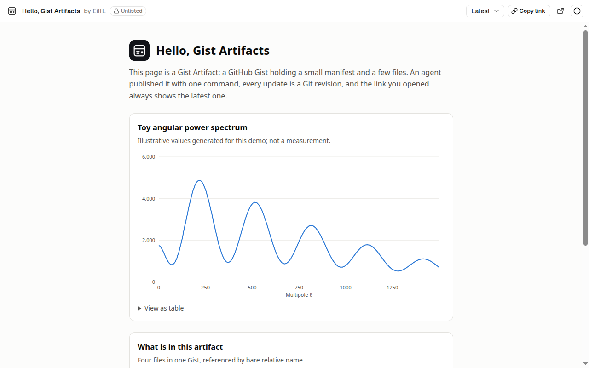

# Gist Artifacts

**Shareable pages from your AI agent, stored in your own GitHub Gists.**

Ask your agent for a report, a chart or an interactive page, and get back a link you can send to anyone. Behind the link is a GitHub Gist that you own. Every update is a new revision, and nobody needs an account to view it.

[](https://gist-artifacts.dev/g/fab233b353d106e591ae37fa12326ba3)

**[Open the example](https://gist-artifacts.dev/g/fab233b353d106e591ae37fa12326ba3)** · [Viewer](https://gist-artifacts.dev) · [Format specification](gist-artifacts-spec.md)

## Why

Agents are good at producing pages: analyses, dashboards, explainers. Sharing them is the awkward part. A file on your disk is not a link, and built-in artifact features keep the page inside one product.

Gist Artifacts puts the page somewhere you already have:

- **You own it.** The artifact is a Gist in your GitHub account. Clone it, fork it, or delete it.
- **One link, always current.** Updates go to the same Gist, so the link you shared keeps working.
- **Every version is kept.** Share the latest version, or a link pinned to one exact revision.
- **Feedback comes back.** People comment on the Gist. Your agent reads the thread and replies.
- **Any agent.** Claude Code, Codex, and other agents that support skills.
- **Open format.** A four-field manifest, specified in this repository and free to implement.

## Get started

**1. Sign in to GitHub** with the [GitHub CLI](https://cli.github.com), granting the `gist` permission:

```bash
gh auth login -s gist
```

**2. Install the skill** in your agent.

Claude Code:

```text
/plugin marketplace add EiffL/artifacts
/plugin install gist-artifacts@gist-artifacts
```

Codex:

```bash
codex plugin marketplace add EiffL/artifacts
codex plugin add gist-artifacts@gist-artifacts
```

Any other agent, through the [`skills`](https://skills.sh) CLI:

```bash
npx skills add EiffL/artifacts
```

**3. Ask for an artifact.**

> Publish this report as a Gist artifact and give me the link.

The agent writes the page, publishes it, and hands you a link like `https://gist-artifacts.dev/g/<gist-id>`.

## What you can ask for

| You say | What happens |
| --- | --- |
| "Publish this page as a Gist artifact." | A new Gist is created and you get its link. |
| "Update the artifact with the new results." | A new revision of the same Gist. The link does not change. |
| "Give me a link to exactly this version." | A link pinned to the current revision, which never changes. |
| "List my artifacts." | Everything you have published, newest first. |
| "Someone commented on the artifact. Address it." | The agent reads the comments, updates the page, and replies. |

You can publish interactive HTML pages with their data files and images, Markdown documents, SVG and other images, and plain text or JSON.

## The viewer

Every artifact opens at [gist-artifacts.dev](https://gist-artifacts.dev) with:

- the page itself, or its own full-page link;
- a revision picker, to step back through earlier versions;
- the file list, the history, and the comment thread;
- a copy-link button for the latest version or a pinned one.

Sign in with GitHub to get a dashboard of your artifacts and the ones you starred, and to comment, star, fork, rename or delete from the viewer.

The viewer stores nothing. It reads each artifact from GitHub when someone opens it.

## Good to know

- **Unlisted is not private.** Artifacts are secret Gists by default: not discoverable, but anyone with the link can open them. Do not publish anything confidential.
- **Pages run in a sandbox.** Scripts work. On the hosted viewer, browser storage such as `localStorage` does not.
- **Files are flat.** A Gist has no folders, so an artifact is a handful of files side by side, each under 10 MB.
- **The publishing tool needs Node.js 18 or later.** Without it, the agent falls back to the GitHub CLI alone.
- **Codex runs commands without network access by default.** Approve the publish command when it asks.

## The open format

Gist Artifacts is a convention, not a service. An artifact is an ordinary GitHub Gist with one extra file, `artifact.json`, that says what the Gist contains:

```json
{
  "schemaVersion": "0.1",
  "title": "Cosmology Explorer",
  "entrypoint": "index.html",
  "mediaType": "text/html",
  "description": "Interactive exploration of a parameter posterior"
}
```

| Property | Required | Meaning |
| --- | --- | --- |
| `schemaVersion` | yes | Version of the format, currently `"0.1"`. |
| `title` | yes | What the artifact is called. |
| `entrypoint` | yes | The file to open first. |
| `mediaType` | yes | What kind of file that is: `text/html`, `text/markdown`, an image, text or JSON. |
| `description`, `icon`, `generator`, `source` | no | A one-line summary, a pictogram hint, and where the artifact came from. |

A few rules do the rest:

- **Files refer to each other by name.** `index.html` loads `data.json` or `figure1.png` with a plain relative reference, always within one revision.
- **The Gist is the identity, and its commits are the versions.** The manifest holds no ID, no version number and no URL, so a fork or a clone is still a correct artifact.
- **GitHub provides everything else:** storage, ownership, history, forks, and the comment thread.

Because the format lives entirely in the Gist, anyone can write an artifact by hand, build a tool that publishes them, or build another way to display them. If this viewer disappeared tomorrow, every artifact would still be a complete Gist in its owner's account.

- [Specification](gist-artifacts-spec.md): the full convention, with examples and a conformance checklist
- [JSON Schema](schemas/0.1/artifact.schema.json): for validating a manifest

The specification, the schema and all the code here are open source under the MIT license.

## Run your own viewer

The hosted viewer is one deployment of the code in [`viewer`](viewer). You can run your own on Vercel, optionally on your own domain with every artifact isolated on its own subdomain, and point the publishing tool at it with `GIST_ARTIFACTS_VIEWER`. See [`viewer/README.md`](viewer/README.md).

## FAQ

**Do people need an account to view an artifact?**
No. Anyone with the link can open it. A GitHub account is only needed to comment or to use the dashboard.

**Can I make an artifact private?**
No. An unlisted Gist is hidden from search and from your profile, but there is no access control. Use something else for confidential material.

**What happens when my agent updates an artifact?**
It commits to the same Gist. The link shows the new version straight away, and earlier versions stay available through the revision picker or a pinned link.

**Can I publish without an agent?**
Yes. The publishing tool is a single script you can run yourself, and an artifact can even be made by hand with the GitHub CLI. See [CONTRIBUTING.md](CONTRIBUTING.md).

**Is the hosted viewer guaranteed to stay up?**
No. It is a prototype with no service commitment. Your artifacts do not depend on it: they are Gists in your account, and the viewer can be self-hosted.

## Status

A working prototype. The format is a draft at version 0.1 and may still change.

## Contributing and license

Development notes are in [CONTRIBUTING.md](CONTRIBUTING.md). Feedback on the format is welcome in the [issue tracker](https://github.com/EiffL/artifacts/issues).

Released under the [MIT license](LICENSE).
